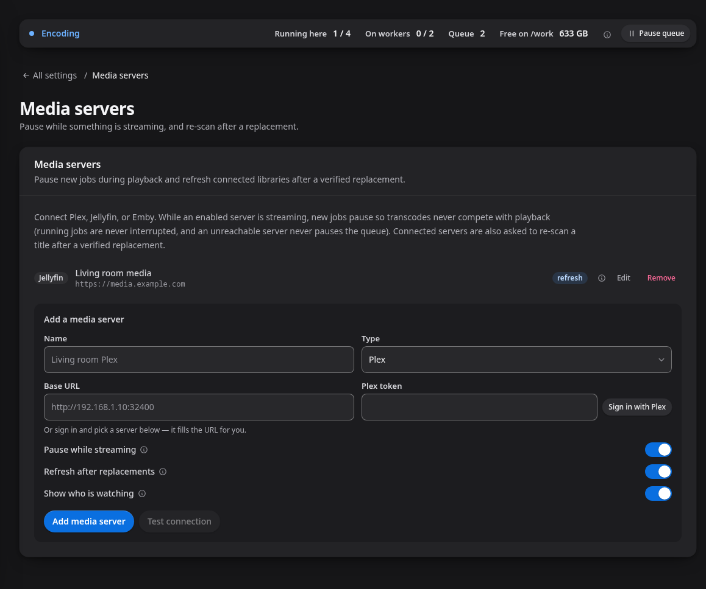
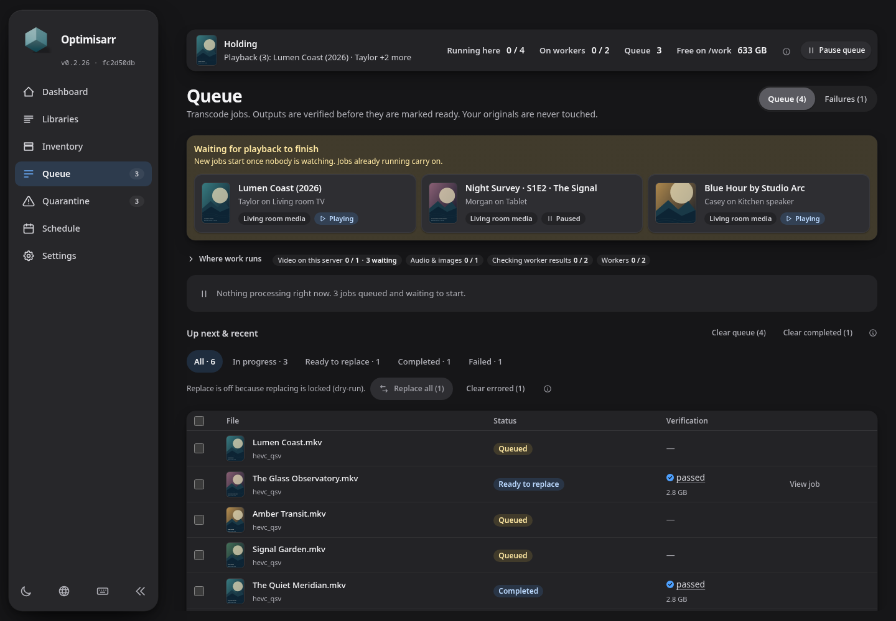
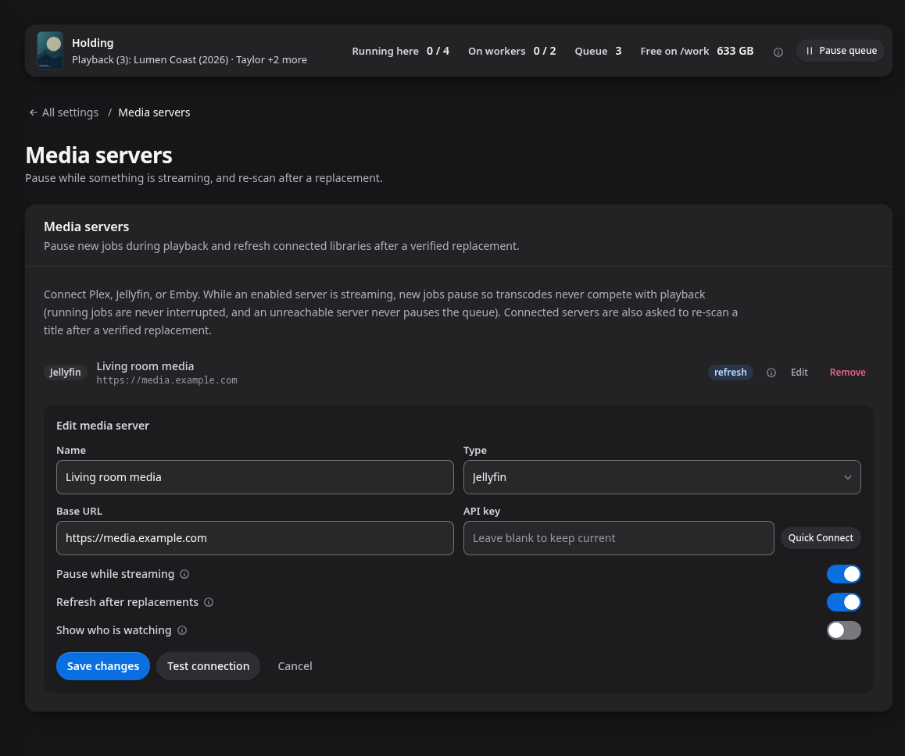
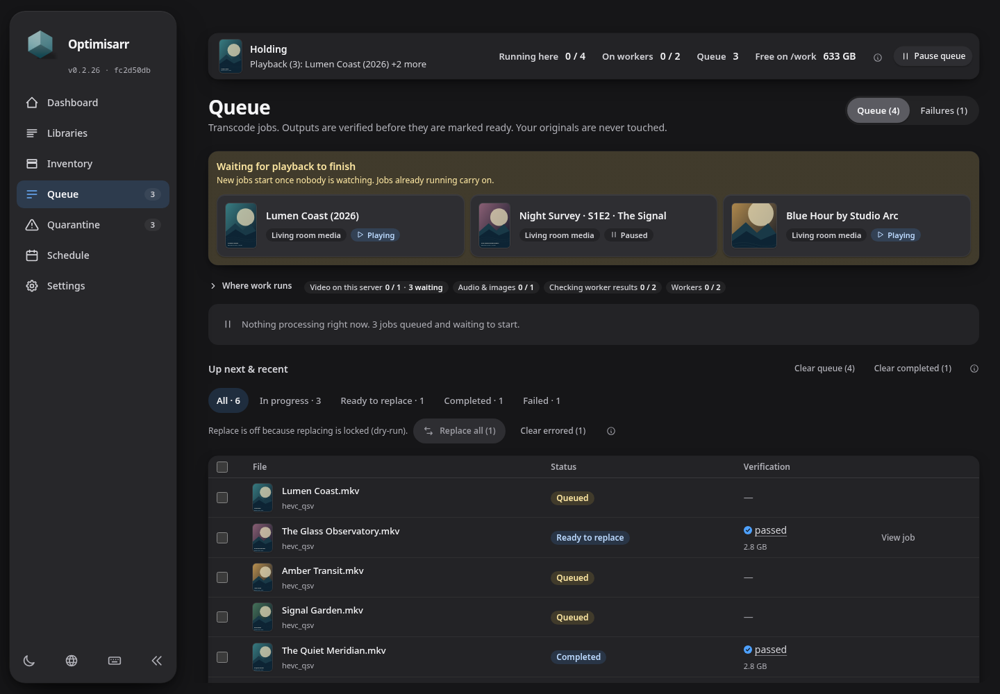
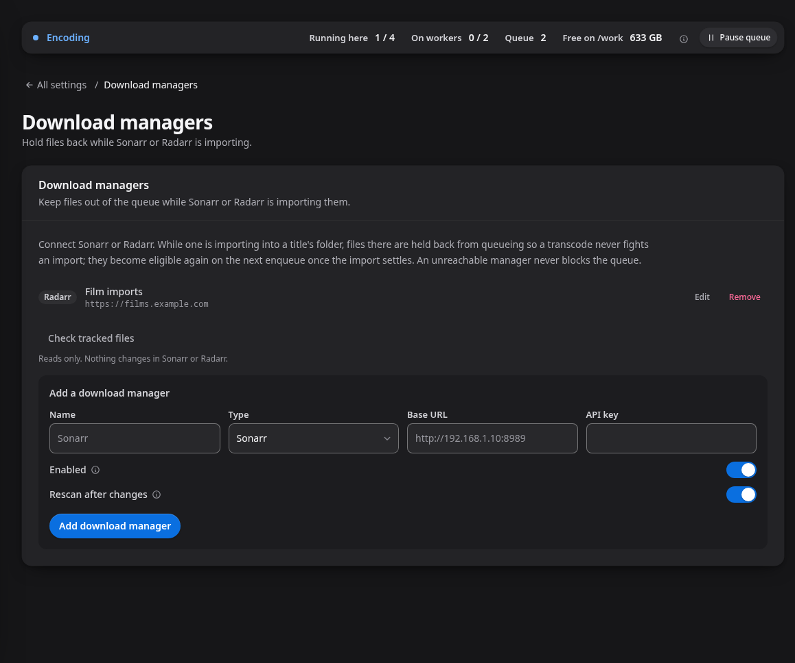

# Media-server integrations

Optimisarr supports configured Plex, Jellyfin, and Emby activity watchers to
pause new work while a service is active. Unreachable watchers do not wedge the
queue. After a replacement or rollback it asks each connected server to rescan:
a changed-folder refresh for Jellyfin/Emby, and a section refresh for Plex.

Configure Plex, Jellyfin, and Emby under **Settings → Media servers**. Configure Sonarr and
Radarr under **Settings → Download managers**.

Screenshots in this page use fabricated dummy media created for documentation.
No copyrighted material is used.

| Service | Use it for | Connection method |
|---|---|---|
| Plex | Pause new work during active sessions; refresh libraries after replacement or rollback. | Plex sign-in/PIN flow, then choose a discovered server or enter the URL manually. |
| Jellyfin | Pause new work during active sessions; refresh changed folders after replacement or rollback. | Quick Connect or API key. |
| Emby | Pause new work during active sessions; refresh changed folders after replacement or rollback. | API key. |
| Sonarr | Avoid immediately reprocessing recently imported TV files; rescan a series after replacement or rollback; pick up an imported episode straight away. | Base URL and API key; optional import webhook. |
| Radarr | Avoid immediately reprocessing recently imported movie files; rescan a movie after replacement or rollback; pick up an imported movie straight away. | Base URL and API key; optional import webhook. |

Test each connection before enabling it. Keep only the pause and refresh
behaviour you actually need.

### What a playback pause shows

While playback holds the queue, Optimisarr says what is playing and who is
watching: the series, season, episode and title for TV, the title and year for a
film, and the track and artist for music, followed by the viewer and device, and
"(paused)" for a paused stream. The status bar shows the first playback and how
many more. Click or tap it to open Queue. The Queue and Schedule pages show up to
eight playbacks, with an expandable list for the rest. Film and TV posters and
square album covers come from the exact item, show or album reported by that
server. Images are proxied by Optimisarr so credentials never reach the browser;
unavailable art leaves a fixed-size placeholder. A detail the server does not report is left out rather than
guessed; if a server reports none, the pause reads as before, with a stream count.

Turn off **Show who is watching** on a watcher and choose **Save changes** to name
only what is playing, which suits a shared server. The viewer and device are then dropped before they leave
the server. Names and titles are only shown to people who can open Optimisarr,
which is protected by the admin token when one is set. They are never written to
logs or diagnostics bundles. They only explain a pause: which sessions pause the
queue is unchanged.

After saving, the pause still identifies the titles while omitting viewers and devices:

## Sonarr and Radarr

Configure import-aware exclusions under **Settings → Download managers**.

**Rescan after changes** asks the manager to rescan a title after Optimisarr
replaces one of its files or restores an original, so the manager tracks the
file now on disk instead of waiting for its own scheduled scan. Optimisarr reads
the manager's movie or series list, finds the one title whose folder holds the
changed file, and sends `RescanMovie` or `RescanSeries`. Only the folders where
the manager keeps files are compared: the file's own folder for a movie, and
the file's folder or the one above it, such as a season folder, for a series. It never deletes,
searches, or changes the manager's settings. When no single title fits, it sends
nothing and logs why. A failed rescan never affects the replacement itself.

It is on for new connections and off for connections saved before it existed,
including connections restored from a backup made before then.
When a replacement changes the file name, for example `.mkv` to `.mp4`, the
manager sees the old file as gone. Radarr then unmonitors the movie if its
**Unmonitor Deleted Movies** setting is on, so check that setting, or keep file
names unchanged with the **Same as source** output container.

### Import webhook

Without a webhook, a newly imported file waits for the next library scan
(**Settings → Encoding → Library scan interval**, hourly by default). The import
webhook lets Sonarr or Radarr tell Optimisarr the moment it imports or upgrades a
file, so Optimisarr picks up just that file:

1. It finds the library whose folder holds the file. A file outside every
   enabled library is left alone and the delivery still succeeds.
2. It checks the file exactly as a library scan would. A file modified within
   the settling period (two minutes) is looked at again once it settles. Links
   out of the library and paths containing `..` are refused. The file is
   recorded under its name as spelled on disk, whatever letter case the manager
   used.
3. It probes the file and queues it only if the library optimises
   automatically, is inside its schedule, and its rules select the file. That is
   the same decision automatic optimisation makes every minute, so the webhook
   never queues anything automatic optimisation would not. A library that does
   not optimise automatically only gains the file in its inventory.

The library scan carries on as before and still finds anything a webhook
missed, for example a delivery made while Optimisarr was restarting.

#### Set it up

1. In Optimisarr, open **Settings → Download managers**, choose **Edit** on the
   connection, and choose **Create webhook password**. Copy the password now:
   Optimisarr keeps only a fingerprint of it and cannot show it again. If you
   lose it, choose **Replace password**.
2. In Sonarr or Radarr, open **Settings → Connect**, add a connection and choose
   **Webhook**.
3. Turn on **On File Import** and **On File Upgrade** (**On Import** and **On
   Upgrade** in older versions). Leave the other triggers off; Optimisarr
   accepts them but does nothing with them.
4. Paste the **Webhook URL** Optimisarr shows, leave **Method** as **POST**, and
   enter the **Username** and **Password** Optimisarr shows.
5. Choose **Test**. Optimisarr shows the result under **Last delivery**.

The URL is built from the address you opened Optimisarr at. If Sonarr or
Radarr reaches Optimisarr at a different address, such as its container name,
use that address with the same path, `/api/arr-webhooks/<id>`.

If Sonarr or Radarr sees your library under a different folder than Optimisarr
does, for example `/tv` in Sonarr and `/data/tv` in Optimisarr, set the
connection's **Path mapping** to those two folders. Only the start of the path
is rewritten, and the result must still be inside a library.

#### Security

The webhook does not use the admin token, because Sonarr and Radarr cannot send
it. Each connection has its own 32-byte random password, sent with HTTP basic
authentication from the webhook's username and password fields. Any username is
accepted. The password is not in the URL, so it does not end up in proxy access
logs. Optimisarr stores only its SHA-256 fingerprint, and a backup export never
includes it. A restored connection has its webhook off until you create a new
password. **Turn off webhook** removes the password and refuses every
delivery. Each delivery body is limited to 1 MiB, and deliveries are processed
one at a time.

Use Optimisarr's HTTPS address for the webhook URL wherever Sonarr or Radarr
can reach it: basic authentication over plain HTTP can be read by anyone on the
network path.

If your reverse proxy adds its own sign-in, exempt `/api/arr-webhooks/` from it
or Sonarr and Radarr cannot reach the webhook. See [Running behind a reverse
proxy](../setup/reverse-proxy.md#built-in-admin-token).

#### Troubleshooting

**Last delivery** shows when Optimisarr last heard from the manager and what it
did:

| Result | Meaning |
|---|---|
| Test received | The manager's **Test** reached Optimisarr with the right password. |
| Queued | The file was added to the queue. |
| Not queued | The file is in the inventory but was not queued. The detail says why, for example the library does not optimise automatically, it is outside its schedule, or its rules skip the file. |
| Waiting for the file to finish writing | The file was modified within the settling period. Optimisarr looks again once it settles. |
| Waiting for a library scan to finish | A scan of the file's library was recording files. Optimisarr looks again about 30 seconds later rather than holding the delivery. |
| Not in any enabled library | The file's path, after any path mapping, is not inside an enabled library. Check the path mapping. |
| Refused | The delivery named a path Optimisarr will not accept, or a file it cannot find. The detail says which. |
| Ignored | The event was not an import or upgrade, or the connection is turned off. |

A wrong password gets `401` and records nothing. The manager marks the
connection as failing for that, for a malformed body, and when Optimisarr is
busy for over a minute with earlier deliveries (`503`). Every other result is a
successful delivery.

## Notifications

Notification targets live under **Settings → Notifications**. Supported targets
are generic webhook, Discord, Telegram, ntfy, and Apprise. Discord webhook URLs
are detected automatically and sent as embeds. Telegram sends through the official
Bot API and opportunistically includes artwork Optimisarr already knows: a film/TV
poster, embedded audio cover, or image thumbnail. Artwork lookup has a short budget;
if no suitable image is available or it is too large, Optimisarr sends plain text instead.
If Telegram explicitly rejects an uploaded image as invalid or unsupported, Optimisarr retries the
same notification as text. It does not retry ambiguous timeouts, rate limits, or server failures,
because the photo request may already have succeeded. Targets can notify on
replacement and on job failure. After saving a target, use **Test** to send a clearly
labelled test through that provider immediately. Optimisarr reports success or a short
failure reason inline.

### Telegram setup

1. Create a bot with [@BotFather](https://t.me/BotFather) using `/newbot`, and keep
   the generated bot token secret.
2. Start a private chat with the bot, add it to the target group, or add it to a
   channel with permission to post. Bots cannot initiate a private conversation
   before the user starts them.
3. In Optimisarr, choose **Telegram**, enter the numeric chat ID (for a private chat
   or group) or a public channel username such as `@my_channel`, then paste the bot
   token. For a numeric ID, send the bot a message and inspect `message.chat.id` in
   the official Bot API `getUpdates` response.
4. Choose whether the target receives replacement notifications, failure
   notifications, or both, then save it.

The token is write-only in the Optimisarr API and UI. Do not paste it into logs,
screenshots, support issues, or a notification target's Chat ID field. See
Telegram's official [BotFather guide](https://core.telegram.org/bots/features#botfather),
[`sendMessage` reference](https://core.telegram.org/bots/api#sendmessage), and
[`sendPhoto` reference](https://core.telegram.org/bots/api#sendphoto).

## Backup warning

Exported configuration includes provider secrets so it can restore a working
setup. Treat the JSON file as sensitive material and never commit or share it.
