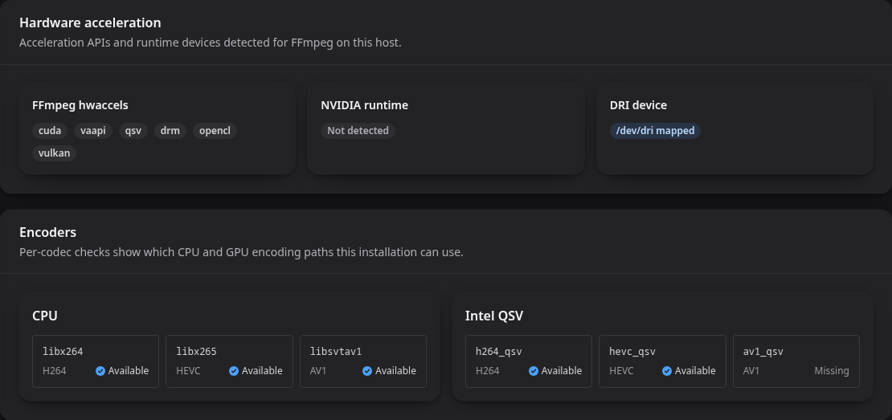

# Hardware acceleration

See the maintained [hardware validation matrix](hardware-validation-matrix.md) for the distinction
between automated implementation coverage and paths proven on a physical GPU.

Use **Settings → System → Tools** after deployment. Optimisarr verifies each available
encoder with a real test encode; a GPU device node alone is not sufficient.

Screenshots in this page use fabricated dummy media created for documentation.
No copyrighted material is used.



The bundled Jellyfin FFmpeg is used for both hardware detection and transcoding, so the
Tools page is the source of truth for what this container can actually encode. A separate
static FFmpeg supplies the optional `libvmaf` quality-measurement filter and appears as its
own Tools entry. A configured `OPTIMISARR_FFMPEG_VMAF_CUDA` binary appears separately and is usable
only when it exposes `libvmaf_cuda`; actual GPU/driver/source compatibility is checked by the first
measurement. Runtime failures fall back to software, and a measured hardware-decoded score below
the selected quality floor is confirmed in software before the output is rejected. The Queue shows
the selected encoder on each job.

## Encoder effort

The per-library **Encoder effort** setting describes intent rather than storing a raw FFmpeg
preset. Optimisarr resolves it after the exact encoder has been selected:

| Effort | x264/x265 | SVT-AV1 | NVIDIA NVENC | Intel QSV | VAAPI |
|---|---|---:|---|---|---|
| Fast | `fast` | `10` | `p2` | `fast` | Driver default |
| Balanced | `medium` | `8` | `p4` | `medium` | Driver default |
| Efficient | `slow` | `6` | `p7` | `slow` | Driver default |

This is particularly important in **Auto** mode, where the encoder depends on the target codec,
proved host capabilities, and source bit depth. Existing libraries, API requests, and imported
backups may retain a former x264/x265 value, NVENC `p1`–`p7`, or SVT-AV1 `0`–`13` preset. That exact
value remains in force on its native encoder and stays visibly labelled as legacy until the operator
chooses a portable effort; another encoder family receives its closest safe equivalent. Any
unrecognised value is rejected before a job can reach FFmpeg.

## Intel and AMD

Map `/dev/dri` and set `RENDER_GID` to the host render-node group:

```bash
stat -c '%g' /dev/dri/renderD128
```

Use [Intel QSV](../../compose.intel-qsv.example.yml) or
[Intel/AMD VA-API](../../compose.vaapi.example.yml). Both map `/dev/dri` and
use `RENDER_GID` for render-node access; select **Intel QSV** or **VA-API** in
Settings after Tools has validated the encoder.

### HDR-to-SDR tone mapping

The per-library **HDR handling** drop-down remains the output policy: only **Tone-map to SDR**
requests a colour conversion. **Settings → Encoding → HDR tone-map engine** chooses its
machine-specific implementation:

- **Software (compatible)** is the default and uses the established `zscale`/Hable Rec.709 path.
- **Hardware when supported** freshly confirms HDR10/PQ input, then keeps decode, tone mapping,
  and encode on Intel QSV or VA-API surfaces when Hardware decoding is also enabled.

Preview and personal-quality clips retain software decoding to preserve exact frame identity.
VMAF-gated HDR→SDR jobs also retain the software production transform so the reference can receive
the identical colour conversion. HLG, Dolby Vision, and unknown transfer metadata also stay on the
compatible software transform because FFmpeg documents `tonemap_vaapi` as HDR10-only. NVIDIA
currently retains software tone mapping; NVENC may still encode the result. If a supported
Intel/VA-API filter or its driver fails to initialise, Optimisarr deletes the partial work output
and retries once with software decode and tone mapping. The normal decode, HDR-signal, Rec.709
metadata, timing, stream, size, and optional VMAF verification gates still decide whether the
completed output may replace its original.

## NVIDIA

Install NVIDIA Container Toolkit and configure `NVIDIA_VISIBLE_DEVICES=all` and
`NVIDIA_DRIVER_CAPABILITIES=compute,video,utility`. The `video` capability is
required for NVENC and NVDEC. If you also enable experimental AI super-resolution,
add `graphics` (`compute,video,utility,graphics`) so Vulkan sees the NVIDIA GPU
instead of falling back to CPU rendering (`llvmpipe`). Use the [NVIDIA Compose example](../../compose.nvidia.example.yml)
and select a hardware mode only after Tools reports success.

### Install the driver on a Debian or Ubuntu host

The container uses the host's NVIDIA driver, so the driver and the NVIDIA Container Toolkit are
installed on the host, not in Optimisarr. Optimisarr never changes host drivers. These steps keep
**Secure Boot on**, which matters if the machine also boots Windows.

**Check your card is supported.** GeForce 10-series (Pascal) and older cards are dropped by the newest
NVIDIA driver branches. Debian's packaged drivers (535 on Debian 12, 550 on Debian 13) still support
Pascal. If you install a driver from NVIDIA or a PPA instead, use branch 580 or older for a 10-series
card.

**Debian 12 or 13**

1. Enable the `contrib`, `non-free` and `non-free-firmware` components for the main and security
   suites in your APT sources, then run `sudo apt update`.
2. Install the headers and driver for the standard 64-bit PC kernel:
   - Debian 12: `sudo apt install linux-headers-amd64 nvidia-driver firmware-misc-nonfree`
   - Debian 13: `sudo apt install linux-headers-amd64 nvidia-kernel-dkms nvidia-driver firmware-misc-nonfree`

   DKMS builds the `nvidia` module for your kernel. With Secure Boot on, it signs the module with a
   machine owner key (MOK) that it creates on first use, at `/var/lib/dkms/mok.key` and
   `/var/lib/dkms/mok.pub`.
3. Enrol that key so the firmware trusts the module:

   ```bash
   sudo mokutil --import /var/lib/dkms/mok.pub   # asks you to choose a one-time password
   sudo mokutil --list-new                       # confirms it is queued for the next boot
   ```

4. Reboot. Before the system starts, a blue screen says to press a key for MOK management. Press a
   key within about ten seconds, choose **Enroll MOK**, then **Continue**, then **Yes**, enter the
   one-time password, and reboot. If you miss it, run the `mokutil --import` command again and
   reboot.
5. Check it worked:

   ```bash
   mokutil --sb-state          # SecureBoot enabled
   dkms status 'nvidia*'       # installed for the running kernel
   nvidia-smi                  # lists the GPU and driver version
   ```

   If `nvidia-smi` says it cannot communicate with the driver while Secure Boot is on, the key is
   usually not enrolled yet; repeat steps 3 and 4.

See Debian's [NVIDIA driver](https://wiki.debian.org/NvidiaGraphicsDrivers) and
[Secure Boot](https://wiki.debian.org/SecureBoot) pages for other releases and details.

**Ubuntu**

1. Run `sudo ubuntu-drivers install`. It picks the recommended driver for the card; to choose one, list
   them with `ubuntu-drivers list` and install with `sudo ubuntu-drivers install nvidia:580`.
2. Ubuntu normally installs prebuilt modules that Canonical has already signed, so Secure Boot needs
   nothing more. If it has to build the module with DKMS instead, the installer asks you to choose a
   Secure Boot password; at the next boot use the same **MOK management** screen as above (Enroll
   MOK, Continue, Yes, the password).
3. Reboot and check with `mokutil --sb-state` and `nvidia-smi`.

**Then, on either system: the container toolkit**

1. Install the NVIDIA Container Toolkit from NVIDIA's APT repository, following
   [NVIDIA's install guide](https://docs.nvidia.com/datacenter/cloud-native/container-toolkit/latest/install-guide.html).
2. Point Docker at it and restart Docker:

   ```bash
   sudo nvidia-ctk runtime configure --runtime=docker
   sudo systemctl restart docker
   ```

3. Check a container can see the GPU: `docker run --rm --gpus all ubuntu nvidia-smi`.
4. Start Optimisarr from the [NVIDIA Compose example](../../compose.nvidia.example.yml) and check
   **Settings → System → Tools** reports NVENC before choosing it.

With **Hardware decoding** enabled (the default), an NVENC transcode uses FFmpeg's
`-hwaccel cuda -hwaccel_output_format cuda` path. FFmpeg selects the compatible NVDEC decoder for
the source codec and keeps the decoded frames in CUDA memory for NVENC; Optimisarr does not force a
codec-specific `*_cuvid` decoder. If the source codec or profile is unsupported, device setup fails,
or the CUDA decode path cannot initialise, the job deletes the partial work output and retries once
with software decoding. HDR-to-SDR work currently uses the software tone-map path with NVENC.

For systems with no GPU, use the [CPU-only Compose example](../../compose.cpu.example.yml).

Hardware decode is used with hardware encoders when possible and retries with
software decode when a source cannot be decoded on the GPU. Eligible SDR VMAF passes use the same
selection: Intel QSV and VA-API can decode both inputs before downloading frames for CPU scoring.
That GPU-to-RAM copy means hardware decode is not guaranteed to be faster; benchmark it on the host.
There is no Intel/AMD/NPU backend for VMAF's feature extractors.

The always-on video bit-depth gate also keeps the H.264 compatibility promise honest. Normal,
preview, and personal-quality work never queues H.264 output for a source above 8-bit; the source is
left untouched with guidance to use HEVC or AV1 instead. A source whose bit depth cannot be proved is
also skipped until it is re-probed. The lower-level encoder checks remain as a defensive backstop:
supported NVENC, Intel QSV, and VA-API H.264 paths cannot preserve a 10-bit source, and Optimisarr
never silently converts one to 8-bit.

NVIDIA is the only full scoring-acceleration path. Supply an FFmpeg build with `libvmaf_cuda`,
FFmpeg NVIDIA codec support, and `scale_cuda` through `OPTIMISARR_FFMPEG_VMAF_CUDA`; Optimisarr then
uses NVDEC and keeps both SDR streams in CUDA memory. HDR remains on the software path so its 10-bit
and tone-map preparation is unchanged. See FFmpeg's official
[`libvmaf_cuda` example](https://ffmpeg.org/ffmpeg-filters.html#libvmaf_005fcuda) and
[hardware-acceleration caveats](https://ffmpeg.org/ffmpeg.html#Advanced-Video-options).

GPU usage graphs require an unprivileged metrics source. Intel/AMD are read from
DRM fdinfo and NVIDIA from `nvidia-smi`; if neither is available, encoding can
still work while the UI reports GPU stats unavailable.

Contributors with a physical NVIDIA system can run the packaged
[NVENC quality comparison](nvenc-quality-comparison.md). It creates a private test folder under the
mapped storage root, leaves all supplied clips unchanged, and produces one anonymous text report for
[issue #37](https://github.com/Jellman86/optimisarr/issues/37). The comparison does not alter normal
Optimisarr encoding settings.

### Quality scoring with VMAF v1

Ordinary SDR uses complete VMAF v1 on CPU, including on remote workers. NVENC, VideoToolbox,
QSV and VAAPI can still encode; this does not mean v1's quality features run on the GPU. Current
upstream CUDA lacks the full v1 feature set. The optional CUDA configuration above applies only
to compatible legacy models. Update sidecars with the server: protocol 7 proves both HD/UHD v1
models and supplies the candidate's actual encoded format. HDR, high frame rates and conversions
retain legacy scoring until their v1 policies are validated.

Optional re-encoded soundtrack assessment has a separate minimum: protocol 14 and full-verification
contract 3. Update the sidecar before enabling these controls for strict worker jobs. Zimtohrli
measurement runs on the assigned verification host, without a server fallback for strict jobs.
See [soundtrack coverage and cost](configuration.md#assess-re-encoded-video-soundtracks).
