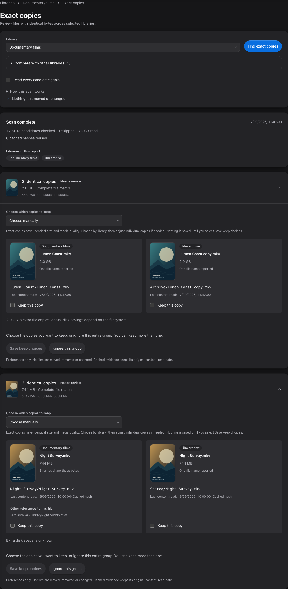

# Find exact file copies

**Inventory → Exact copies** finds files with identical complete bytes within one library.
It works with Film, TV, Music, Photo and Other libraries. Nothing is removed or changed.

1. Scan the library so its files appear in **Inventory**.
2. Open **Exact copies** and choose a **Library**.
3. Select **Find exact copies**. You can leave the page while the scan runs, or select
   **Cancel scan** to stop it.
4. Open a group to see its file locations, reported link counts and **Last content read** dates.
5. Use **Next groups** and **Previous groups** to browse the saved result.

In development, scans normally reuse complete hashes when file identity, path, size,
modification time and hash contract match. Select **Read every candidate again** to force
full content reads. File size and timestamps cannot reveal every in-place edit, especially
when an editor restores timestamps. A reused hash keeps its original content-read date;
a metadata check does not make it freshly verified. Unsupported identities are not reused.

This screenshot uses fabricated dummy media created for documentation. No copyrighted material
or real user library data is used.

## What the report means

Optimisarr compares the entire file using SHA-256, a content hash. Different tags, containers,
formats or encodes will not match, even if they play the same recording or show the same image.
Empty files and files with unique sizes do not need hashing. Files with unfinished jobs are
excluded from the candidate list. Changed, missing, unreadable or redirected paths are skipped.

**Extra file copies** counts logical file bytes beyond one copy when each checked file reports
one name. It is not a promise of recoverable disk space. Compression, shared filesystem blocks
and storage outside the selected library can affect actual savings. If any file has multiple
hard links or an unknown link count, the group shows **Extra disk space is unknown**.
Windows link counts are currently unknown.

Reports are snapshots from the time each file was checked. Scan again after files change.
In development, the latest scan for each library and its results persist in the application
SQLite database across server restarts. Starting another scan replaces that library's previous
report. Cancelling or interrupting a scan never publishes a completed partial report. Completed,
stable file reads are checkpointed in batches of 32 and may be reused by the next explicit scan;
a crash may lose the uncommitted batch, which is safely reread. Partial SHA-256 state is never
saved. Interrupted work is labelled and requires **Find exact copies** to restart.

An **Inventory has changed** warning means indexed candidates, unfinished-job exclusions or
the library root no longer match the saved scan scope. It does not continuously inspect disk
contents. Rescan the library inventory after changes, then rerun this review. Live files may
change without an inventory update, so a report without this warning is still a snapshot.

These persistence and refresh changes are newer than stable 0.2.23.
[Validation and resource measurements](../development/exact-copy-index-acceptance.md) record
the disposable study and platform coverage.

## Cost and limits

Scans run only when requested. One scan runs across the application at a time, on the server,
with file reads capped near 8 MiB/s. This still uses disk and CPU; a large library can take hours.
No encode slot is reserved and verification placement is unchanged. Workers do not hash these
duplicate candidates in this first version.

This preview accepts at most 50,000 same-sized candidates in one library and displays at most
20 groups per page with up to 100 copies in each. Each page also has a total budget of
2,000 copy locations and 500,000 path characters. All accepted groups remain in the saved
result and are reachable through pagination. Group headings retain their full copy count; shortened groups show
no extra-copy byte total. Completed scan
counts cover all accepted candidates, including groups beyond the display limit.

The cache retains at most one fingerprint per indexed media entry and is removed with that
entry. The latest scan retains at most 50,000 completed observations per library and is removed
with the library. Back up `/config`, including its database, to preserve the index and reports.

There are no removal, quarantine, automatic dedupe or hard-link conversion actions.
Comparisons across libraries, persisted review decisions, reversible exact-copy quarantine
and separately qualified similarity matching remain in [issue #397](https://github.com/Jellman86/optimisarr/issues/397).

If a file is skipped, check access and let its unfinished job complete, then scan the library
and try again. If another duplicate scan is running, finish or cancel that scan first.
