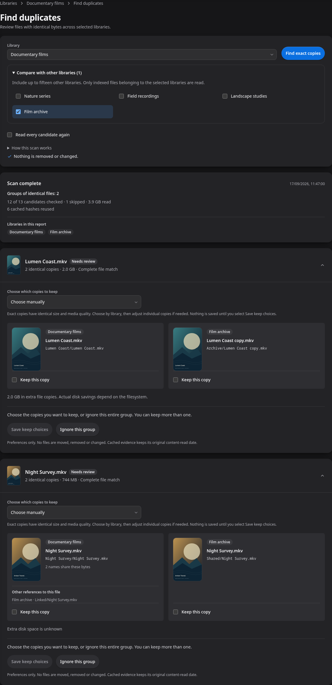

# Find exact file copies

**Libraries → Find duplicates** opens an exact-copy review for that library. The library
configuration overview has the same action. **Inventory → Exact copies** also remains available.
It works with Film, TV, Music, Photo and Other libraries. A scan changes no media files.

1. Scan each library so its files appear in **Inventory**.
2. Open **Find duplicates** on a library card, or choose a **Library** in **Exact copies**.
3. In the open **Compare with other libraries** section, optionally select additional libraries.
   The starting library is always included. Opening this page never starts a scan.
4. Select **Find exact copies**. You can leave the page while it runs, or **Cancel scan**.
5. Open a group to inspect its filename, copy count, size, library names, copy locations and other
   references to the same physical file. Unknown or multiple hard links are labelled; SHA-256 is
   available in the group’s tooltip.
6. Select the copies you want to keep, then **Save keep choices**. You can keep several copies,
   **Ignore this group**, or clear a saved preference with **Review again**.
7. Use **Next groups** and **Previous groups** to browse the saved result.

Progress advances during large-file reads and includes cached and skipped work. The percentage
remains below 100% until the server reports completion.

**Choose which copies to keep** offers manual selection, **Keep all copies**, and copies in a
preferred library. These controls change the draft selection; saving is explicit. Nothing is
selected for a new group. Exact byte copies have identical size and media quality, so smallest,
largest and highest-quality rules would tie. Those strategies belong to later non-identical
matching, with protected versions and clearly explained evidence.

This screenshot uses fabricated dummy media created for documentation. No copyrighted material
or real user library data is used. Artwork helps recognition; it is never matching evidence.

## What the report means

Optimisarr compares the entire file using SHA-256, a content hash. Different tags, containers,
formats or encodes will not match, even if they play the same recording or show the same image.
Empty files and files with unique sizes within the selected scope do not need hashing. Files
with unfinished jobs are excluded. Changed, missing, unreadable or redirected paths are skipped.

Known physical identities are collapsed before counting copies. Overlapping libraries and
hard-link names appear as **Other references to this file**, rather than extra copies. With
unknown identity, identical canonical paths are collapsed but different paths cannot be proven
independent. Unknown identities cannot save review preferences. Conflicting observations of
one known identity are excluded rather than treated as separate copies.

**Extra file copies** counts logical bytes beyond one physical copy when each representative
reports one link. It is not a promise of recoverable disk space. Compression, shared filesystem
blocks and storage outside the selected scope affect actual savings. If any copy has multiple
hard links or an unknown link count, **Extra disk space is unknown**. Windows link counts are
currently unknown. Keeping several copies does not change this group-level redundancy estimate.

## Saved evidence and preferences

Scans normally reuse complete hashes when identity, path, size, modification time and hash
contract match. Select **Read every candidate again** to force full content reads. Size and
timestamps cannot reveal every in-place edit, especially when an editor restores timestamps.
A reused hash retains its original content-read date; a metadata check is not fresh verification.
Unsupported identities are not reused.

The latest scan for each starting library persists in SQLite across server restarts. Its scope
is the explicitly selected set of libraries, not a global report. Starting another scan replaces
that starting library's previous report. Cancelled or interrupted scans never publish completed
partial results. Stable reads are checkpointed in batches of 32; a crash can lose the uncommitted
batch, which is safely reread. Partial SHA-256 state is never saved. Interrupted work requires
an explicit **Find exact copies** restart.

Saved keeper/ignore preferences belong to the starting library, selected roots and observed file
generations. They survive an unchanged rescan and server restart. Changing the selected scope,
roots, ownership, membership or observed generation prevents old choices from being applied to
new evidence. Only the latest preference for each starting library, scope, hash and size is kept;
there is no history of every generation. A deleted secondary library remains in the saved scope
and makes it stale until you explicitly choose a new scope and rescan.

Before displaying a page or accepting a preference, Optimisarr checks selected roots and indexed
candidates. Visible files are also checked for identity, size, modification time and safe paths.
A warning disables preference saving. Update the inventory and rerun the review after changes.
These bounded checks do not continuously inspect every file or prove current full bytes. A
report without a warning remains a snapshot. Upgraded single-library reports retain their old
observations, but require an explicit rescan to establish identity evidence for review choices.
Changing the scope controls also disables saving until a scan matches that selection.

These changes are newer than stable 0.2.23. The [D1 resource study](../development/exact-copy-index-acceptance.md)
records indexing measurements; [D2 acceptance](../development/exact-copy-review-acceptance.md)
records cross-library review and platform validation.

## Cost and limits

Scans run only when requested. One scan runs across the application at a time, on the server,
with reads capped near 8 MiB/s. This still uses disk and CPU; large scopes can take hours. No
encode slot is reserved and verification placement is unchanged. Workers do not hash candidates.

The preview accepts up to 16 explicitly selected libraries and 50,000 same-sized candidates in
total. Pages contain up to 20 groups. Each group has up to 100 displayed references, including
aliases; a page also has a budget of 2,000 references and 500,000 path/name characters. Group
headings retain the full physical-copy count. Shortened groups hide extra-copy bytes and cannot
save preferences about unseen paths. Pagination reaches all accepted groups, although an
individual oversized group remains shortened. Counts cover all accepted candidates.

The cache retains one fingerprint per indexed entry, removed with that entry. Each starting
library retains its latest scan of up to 50,000 observations, removed with that library. Back up
`/config`, including SQLite, to preserve reports and preferences.

Hard-link conversion and similarity matching are not available. Similarity matching is tracked in
[issue #397](https://github.com/Jellman86/optimisarr/issues/397).

If a file is skipped, check access and let its unfinished job complete, then update the inventory
and try again. If another duplicate scan is running, finish or cancel that scan first.

## Clean up spare copies

**Quarantine spare copies** moves the copies that can safely go, in one click. Once a report is
current, the page shows how many can move and how much space they hold, and why any others are left
alone. Copies go to Quarantine, marked **Duplicate**. Nothing is deleted at this point, and you can
restore a copy from there. The space is freed when a copy is deleted, either by you or after the
quarantine retention period set in Settings.

Before anything is deleted, the kept copy is read in full. If it has changed or gone, the
quarantined copies stay and can be restored.

Optimisarr chooses what to keep:

1. A copy Sonarr or Radarr tracks stays, because moving it would show as missing. They are asked
   again just before each move, and nothing moves if one cannot answer.
2. A copy with other hard links stays, because moving it frees nothing.
3. A keeper you saved is honoured, but it never makes a tracked copy move.
4. Otherwise the copy with the shallowest, then shortest, path stays.

Identical bytes do not prove two placements are interchangeable, so these are left alone until you
choose a keeper for the group: copies in different libraries, copies with different names, and
extras such as trailers, samples and intros that can belong to several titles. Music, photo and other
libraries are never cleaned automatically, because the same track can belong in two albums.

