# User workflow

This walkthrough takes one small library from first scan to safe replacement.
Do this once manually before enabling automation.

```text
Dashboard -> Libraries -> Inventory -> Preview -> Queue -> Quarantine -> Automation
```

Keep **Dry-run mode** on for the first pass. Dry-run lets Optimisarr scan,
transcode, and verify, but it refuses actions that would move or purge originals.

Screenshots in this guide use fabricated dummy media created for documentation.
No copyrighted material is used.

## 1. Check the Dashboard

Start here after deployment or an update.

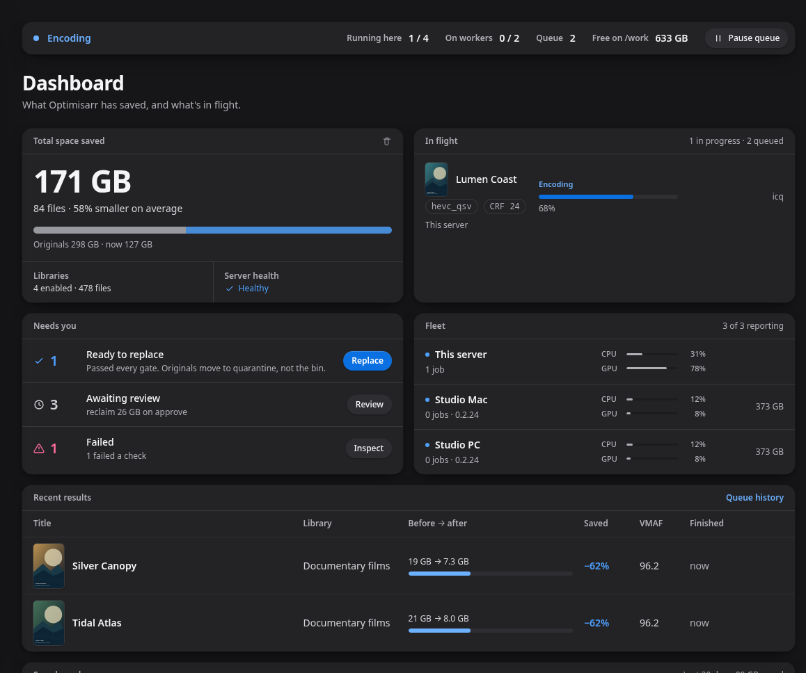

Do this:

1. Open Optimisarr.
2. Confirm **All systems healthy**.
3. Check the Queue, Ready to replace, and Libraries cards.

You should see a green health state before queueing work. If the health card is
not green, open **Settings → System → Tools** or run:

```bash
curl http://localhost:8787/api/ready
```

## 2. Add or review a library

A library is a folder plus rules. Start with one small Film, TV, Music, Photo,
or Other library.

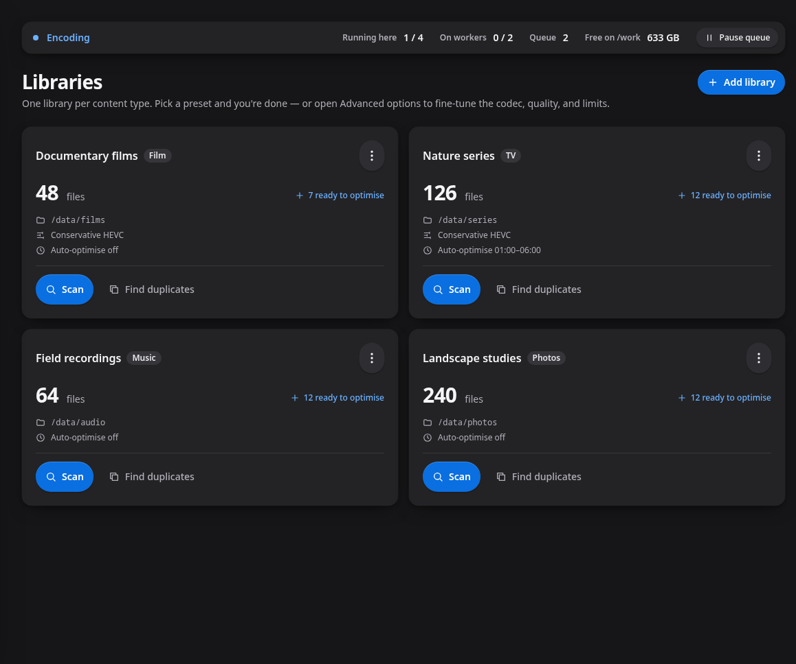

Do this:

1. Go to **Libraries**.
2. Add a library or click **Configure** on an existing one.
3. In **Which files**, use a path as the container sees it, usually below `/data`, and pick the
   media type and the rules for which files are picked up.
4. In **Video**, choose what to do and a preset. Format, quality, picture, encoder and AI
   upscaling are all on that page. **Audio & subtitles** and **Images** hold the rest.
5. For video re-encodes, review **Quality**: new libraries start with **Smallest file that meets
   the target** and the Visually lossless target. A fixed setting can be checked against the
   target or have no picture check.
6. In **Checks**, read the checks that are always on, then switch on the optional ones you want.
   Their tolerances are on the same page.
7. In **Schedule & replace**, choose automation, its hours, queue priority, and what happens to
   your files after they pass.
8. Use the page list, the overview's **Edit** buttons or the breadcrumb to move around. The draft
   is retained, and **Save** applies changes from all pages together.

The page list stays above every settings page; the page being read is filled with the accent colour.

For video audio that is converted, **Audio & subtitles** also offers **Soundtrack quality**,
off by default and separate from standalone audio.
When requiring a limit, choose **Maximum soundtrack difference** in the row below it.
Reports alone do not block replacement; a configured gate needs every retained supported track
and sample to pass. Copied audio and previews skip this assessment. Review the
[supported tracks, sample coverage and cost](../setup/configuration.md#assess-re-encoded-video-soundtracks)
before using it on a library.

The library overview says what the library does, one line per page, with a tag on any line that
changes the picture, renames files, removes tracks or deletes originals later. **Edit** opens the
page with every control for that line.

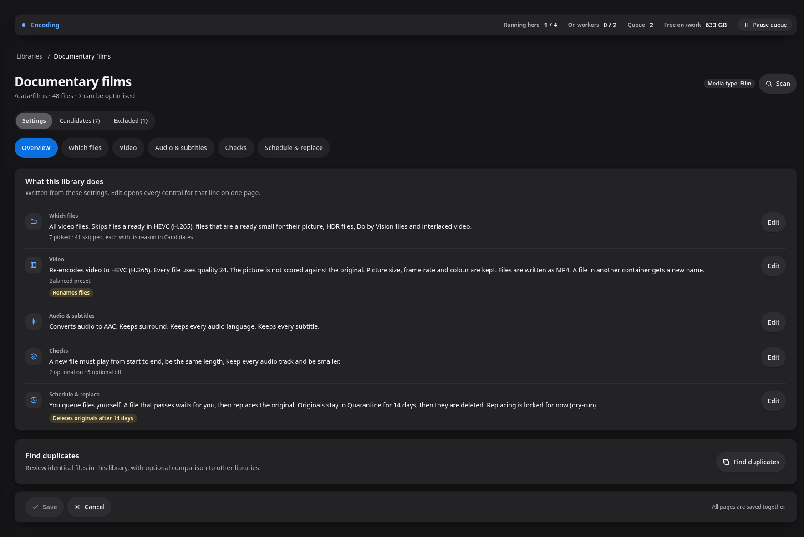

Preset guide:

| Goal | Preset |
|---|---|
| Maximum playback compatibility for 8-bit sources | Compatibility H.264 |
| General space saving | Balanced / Conservative HEVC |
| Smallest files and slower encodes | Efficiency AV1 |
| Scott's compatibility-first setup | Scott's Settings |
| No re-encode, container cleanup only | Remux / cleanup |

Under **Video → Encoder**, **Encoder effort** is portable across encoder modes:

| Choice | Behaviour |
|---|---|
| Encoder default | Let the selected encoder or driver choose |
| Fast | Prefer shorter encoding time |
| Balanced | Use a middle speed/compression trade-off |
| Efficient | Spend more encoding time improving compression |

Optimisarr resolves that choice only after selecting the actual encoder for the file. It therefore
uses valid x264/x265, SVT-AV1, NVIDIA NVENC, or Intel QSV syntax even in **Auto** mode; VAAPI uses its
driver default because it has no consistent cross-codec preset.

Compatibility H.264 is limited to proven 8-bit sources. A source above 8-bit is skipped with guidance
to choose Balanced HEVC or Efficiency AV1, which preserves its bit depth without silently changing
the selected preset. A source whose bit depth cannot be confirmed is skipped until it is re-probed.

VMAF policy guide:

| Goal | Library policy |
|---|---|
| Skip perceptual scoring for this library | Off |
| Prefer smaller outputs | Space-saver or Balanced |
| Protect high-value media more strictly | High, Visually lossless, or Archival |
| Tune exact floors and sampling cost | Custom |

The custom floors must remain ordered: catastrophic frame ≤ fifth percentile ≤ harmonic mean.
Scoring every frame and the full file is the strongest check; three representative samples and
every-Nth-frame scoring trade some coverage for faster verification.

For a more personal starting point, save the library and select **Personal quality check** beside its
optimisation preset. Film, TV, Music, Photo, and mixed libraries can run a blind comparison suited to
their media. Settings and estimated savings stay hidden until you finish, and applying a result only
changes that library's saved quality value; it does not queue or replace media. Follow [Choose a
personal quality setting](personal-quality-check.md) for prerequisites, screenshots, media-specific
controls, HDR limits, result interpretation, and troubleshooting.

You should see **access ok** on the library card. If not, fix the host mount,
`PUID`/`PGID`, or folder permissions before queueing jobs.

## 3. Scan the library

Scanning finds media files. Background probing reads stream details with
`ffprobe` so Optimisarr can explain what it will do.

Do this:

1. Click **Scan** on the library.
2. Wait for the discovered file count to update.
3. Open **Configure → Candidates** to see how the current rules classify files.

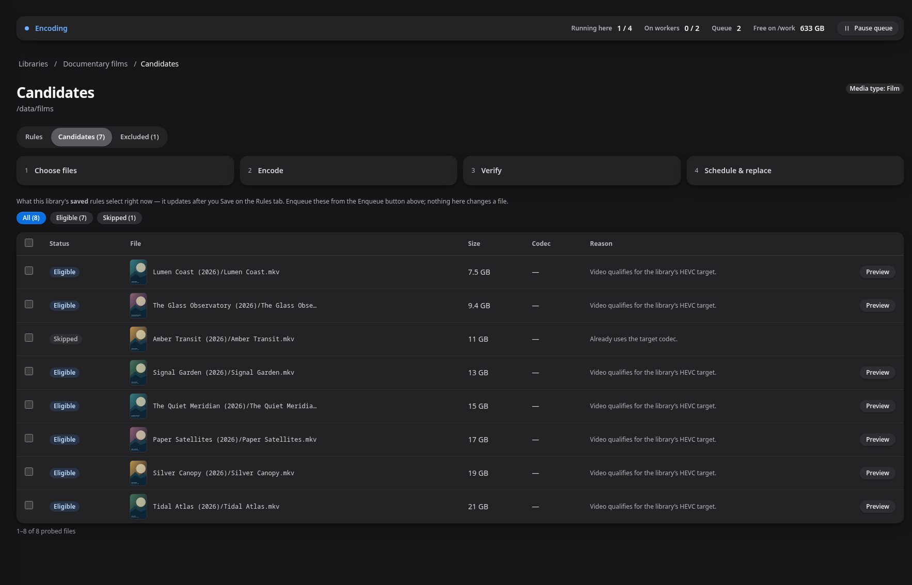

You should see each file marked **Eligible** or **Skipped** with a reason. A
skipped file is not an error; it often means the file is already in the target
codec, too small, excluded, outside a resolution limit, or cannot save space.

## 4. Inspect Inventory

Inventory is the safest place to understand your library before encoding.

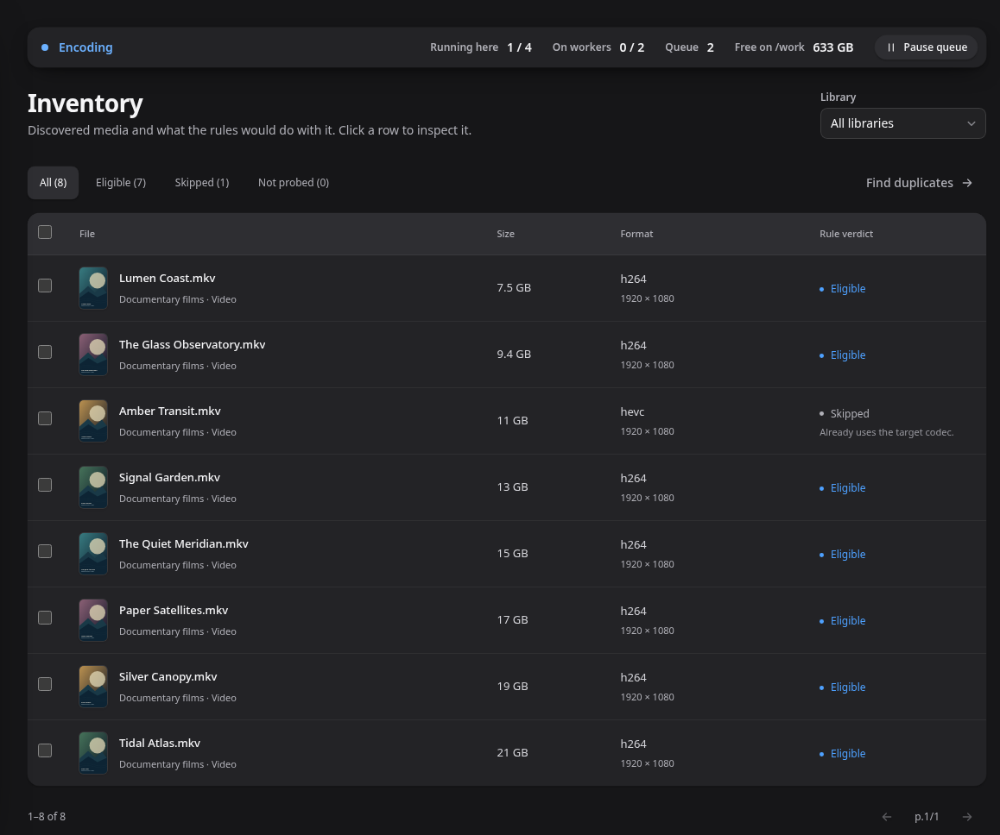

Do this:

1. Go to **Inventory**.
2. Filter to your test library.
3. Click **Eligible** to see what would be queued.
4. Click **Skipped** to sanity-check why files are being ignored.
5. Open a row to inspect details before queueing.

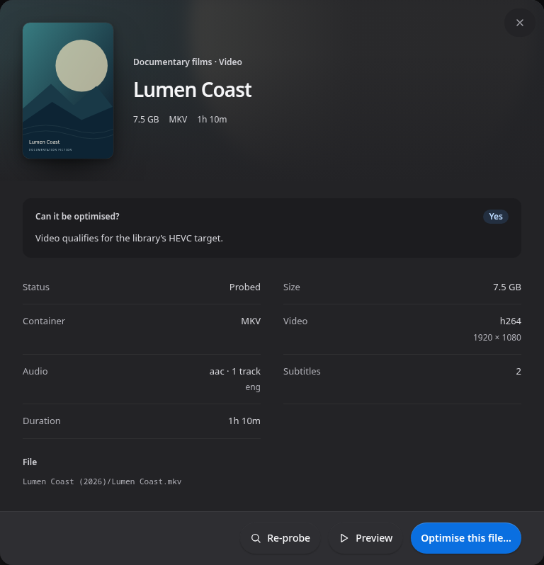

The details answer **Can it be optimised?** with Yes or No and the reason. If the answer is No, the
link under the reason opens the library page that decides which files are taken.

### See what would happen to one file

**Optimise this file…** opens a plan for that file. Opening it changes nothing and queues nothing.

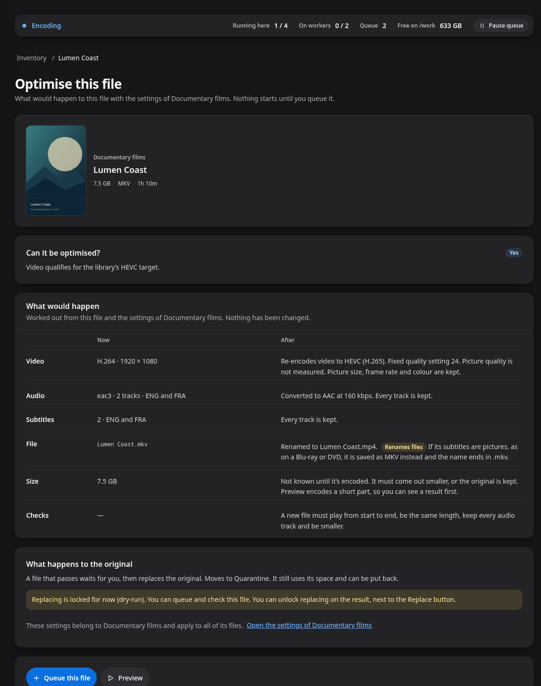

The plan is worked out from the file and its library's settings as they are now:

- **Video**, **Audio**, **Subtitles** and **File** each show what the file is now and what it would be
  after. A setting that changes the picture, removes a track or renames the file is tagged where it is
  described.
- What only the job can measure is said as a rule, not as a fact: a frame-rate cap applies if the
  file runs above it, black bars are cut off if any are found, and the exact new size is given only
  when there are no bars still to measure. A job that would be upscaled with AI says so, and says its
  sound is copied. An image says its format, any resize, and when an already compressed image is
  compressed again.
- **Size** says "Not known until it's encoded". There is no honest number before an encode. **Preview**
  encodes a short part so you can see a result first.
- **What happens to the original** follows the library's choice under **Schedule & replace**.

The settings are the library's and apply to all of its files; the plan cannot be changed for one file.
**Queue this file** adds that one file to the queue. A file the rules skip cannot be queued, and the
page says why.

## 5. Preview one representative file

Preview is a throwaway test encode. Use it before queueing many files.

Do this:

1. Open an eligible Inventory row.
2. Click **Preview**.
3. Compare original and encoded stats.
4. Read the verification report.

Long video previews encode a 60-second sample from the middle of the source and
mark the report as segment-only. The original player opens at that exact source
window while the encoded player opens at zero; **Play both** and either player's
native play, pause, seek, or playback-rate control keep the two source-relative
positions synchronized. You can use each native fullscreen control or download
either exact file for closer inspection. The midpoint follows the freshly measured
primary-picture duration rather than subtitle or attachment timing. A bounded
coarse seek plus exact trim keeps copied audio/subtitles on the same clock as the
re-encoded picture. Audio and image previews run in full.
A preview does not prove every file will pass, but it quickly catches bad
presets, audio choices, HDR handling, or quality thresholds.

## 6. Queue a small batch

Queue only a small test set until you trust the preset.

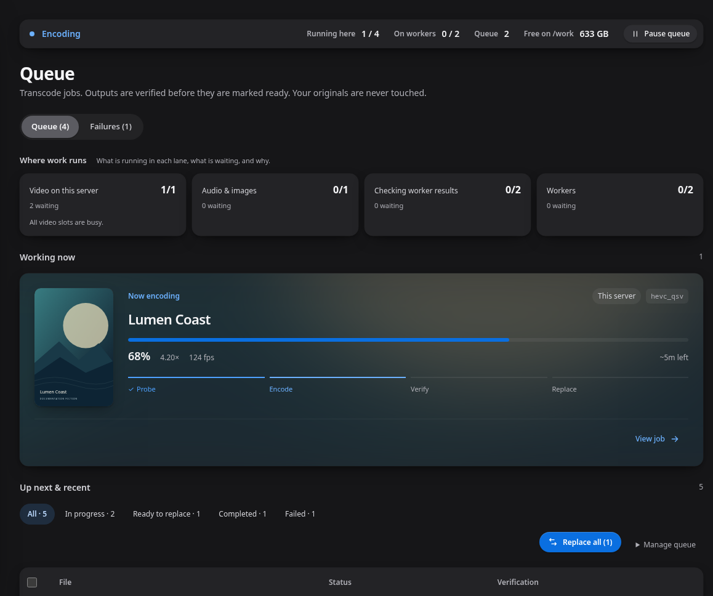

Do this:

1. Go back to **Libraries**.
2. Click **Enqueue** on the test library.
3. Open **Queue**.
4. Watch the status banner, filters, and job rows.

The Queue tells you why work is running or waiting. Common waiting reasons are a
closed auto-optimise window, an activity watcher pause, concurrency limits, or
low free space in `/work`. An activity watcher pause lists what is playing, who is
watching and on which device (see [media servers](../integrations/media-servers.md#what-a-playback-pause-shows)).

For adaptive per-title quality with a required size saving, Optimisarr forecasts
the finished file's size from the quality samples before starting the full encode.
Each 40-second sample is compared with the bytes the source itself spent on the
same scenes, so a busy or quiet sampled scene does not skew the result. That
ratio is applied to the source's picture, with copied audio and subtitles counted
unchanged and re-encoded audio estimated from its target bitrate.

If the chosen quality's samples forecast a file larger than the library allows,
Optimisarr marks the job **Failed** before running the full encode. A sample
that misses the VMAF target and still does not fit also stops the search, because
raising its quality would normally require a larger file. Open the failed job to
read the **Size saving prediction**, estimated growth and sampled scene ratios.
The reason states that this is a prediction and the full encode did not run.

The forecast samples three scenes, so the rest of the video can differ. If you
want to try again, adjust the library's size or quality settings and use **Retry**.
A retry repeats the samples and keeps the final size and quality gates. Originals
are unchanged. Predictions on container, Mac, Windows and Linux workers follow
the same rule. On upgrade, jobs previously held for size review become predicted
size failures; their reasons remain available in the failure history.

Use **Pause queue** at the top right of the Queue page when you need Optimisarr to yield the server
for maintenance or other work. It stops new jobs and automatic replacements from starting. On the
Linux container and on macOS, running transcodes are suspended in place without losing progress;
on an unsupported platform, they finish and the banner says that the pause is dispatch-only.
Verification already underway also finishes, and an automatic replacement already in its protected
quarantine sequence finishes before the pause is acknowledged. Once the paused banner appears, no
new automatic replacement can begin. The pause survives a restart until you select **Resume queue**.

The banner reports partial signal failures instead of claiming every encode stopped. If Resume
cannot continue an active FFmpeg process, dispatch stays paused; select **Resume queue** again after
checking the container log.

During a container update, Optimisarr temporarily continues suspended transcodes so the normal
graceful drain can complete; it does not clear the saved pause. The restarted container therefore
stays paused until you explicitly resume it.

Open any job row to see its media details in a centred dialog, including while work is running.
The dialog opens in the visible viewport even when the queue is scrolled, and closing it returns
you to the same queue position.

Failed outputs remain under `/work` long enough to inspect. **Settings → Files & safety →
Replacement and cleanup → Cleanup retention** controls when the timed sweep removes
their scratch files; the failure report and FFmpeg log remain in Optimisarr. The
same panel shows the space currently eligible for cleanup. Use **Clean up now** to
run the saved policy immediately after reviewing the failed-work/quarantine
breakdown and permanent-deletion confirmation.

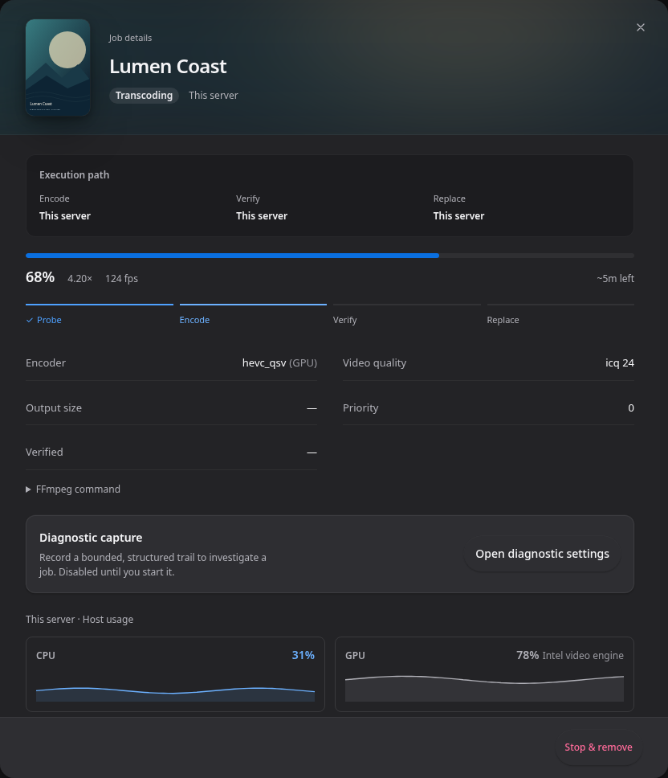

The working-job card keeps progress, the assigned encoder, and **View job** together.

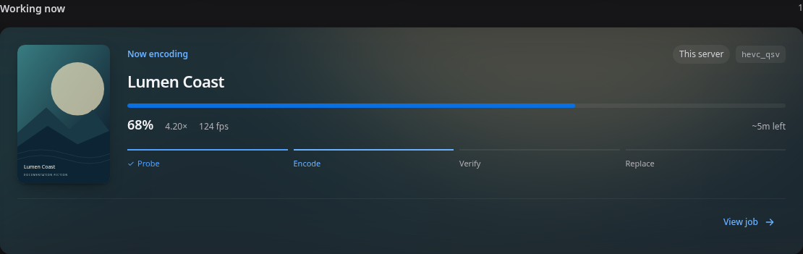

Use row checkboxes to select up to 200 items. Queue supports bulk Retry and Remove; Candidates and
Inventory support exclusion; Excluded supports lifting exclusions; Inventory supports background
re-probing. Review the confirmation and per-file results. Removing active jobs stops them first, and
re-probe progress can be monitored and cancelled.

Use the row actions carefully:

- **Retry** after changing the cause of a failure.
- **Exclude** when you do not want that file offered again.
- **Remove** clears a queue entry when it is safe to clear.
- **Replace** appears only after verification passes and dry-run is off. While dry-run is on, the row
  offers **View job** instead, and **Replace all** is off.
- **Replace all** uses one confirmation for every verified, ready output. Each original still moves to
  Quarantine independently; if any item cannot be replaced, Queue remains open so you can review it.

### Read a job's result

Open a job that has finished its checks to see the result.

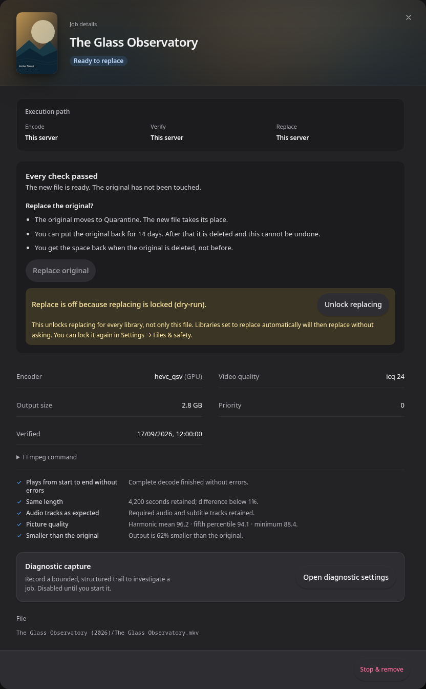

A job that **passed every check** says what replacing does before you press the button: the original
moves to Quarantine, how long you can put it back, and that you get the space back only when the
original is deleted. On a fresh install replacing is locked (dry-run), so **Replace original** is off
and says why. **Unlock replacing** beside it turns dry-run off for every library, not only this file.

Dry-run holds back more than the Replace button, and the text beside the button says so. With it
off, libraries set to replace automatically replace without asking, originals and duplicate copies in
Quarantine are deleted for good once they pass the time limit, and libraries set to clean up
duplicate copies every day start doing so. On a fresh install none of that has anything to act on,
and one press unlocks. When something would happen straight away, the button first shows what, with
counts from the server (files waiting to be replaced, quarantined files past the time limit, libraries
with daily duplicate clean-up), and needs a second press. If the server cannot say, the second press
is still asked for. You can lock it again in **Settings → Files & safety**.

A job that **missed a check** says what you can do instead:

- **Retry at higher quality**, when a measured picture-quality score was the only check missed and
  the quality search had not already tried its highest setting. The library's settings do not change.
- **Change the quality target for the whole library**, when a picture-quality score fell short. This
  changes the check itself, for every file in the library. It is not offered when picture quality
  could not be measured at all: there is no score to compare, so the advice is to retry.
- **Exclude** the file, so it is not offered or queued again.

There is no "replace anyway". A file that missed a check never replaces an original.

Each check is named in plain words, such as "Plays from start to end without errors" or "Same
length". Hover a name to see the name logs and diagnostics use, such as `Decode health`.

## 7. Review exclusions

Exclusions stop repeat failures from wasting time.

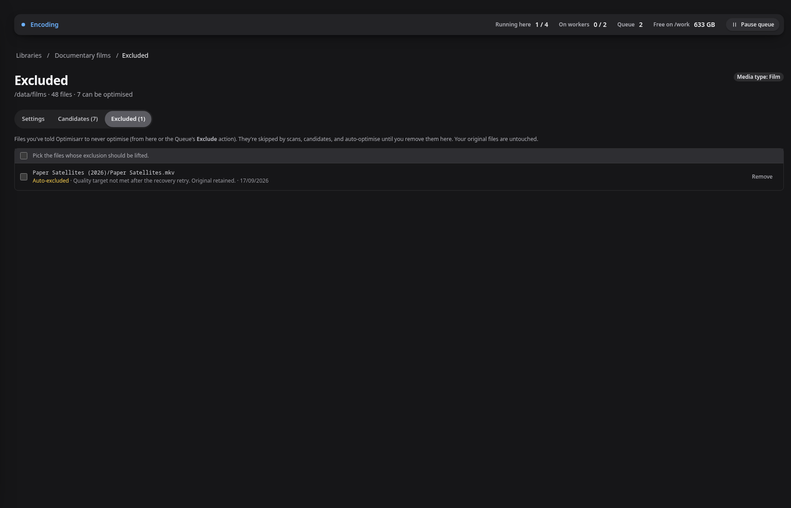

Files can be excluded manually from Queue, or automatically when another encode cannot safely recover:

- a VMAF-only failure gets one higher-quality retry, then excludes if it still fails;
- a size-saving failure excludes immediately rather than lowering the configured quality;
- a combined size and VMAF failure excludes immediately because improving one would worsen the other;
- other terminal failures exclude after three attempts, while cancellations and worker interruptions
  do not count.

The original is untouched, the recorded reason remains visible here, and every automatic exclusion is
reversible. Remove one only when you want the file to become eligible again.

## 8. Replace and review Quarantine

Replacement is the only point where the library path changes.

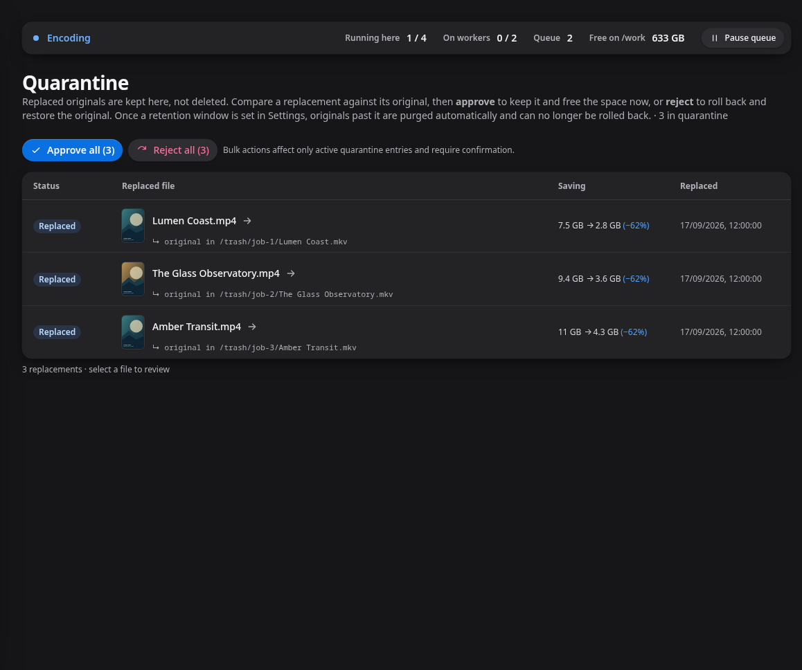

What happens during replacement:

1. The original moves to `/trash`.
2. The verified output moves into the library path.
3. Optimisarr records rollback metadata.
4. Connected media servers are asked to refresh.

In **Quarantine**:

- **Approve** keeps the replacement and permanently removes the quarantined
  original.
- **Reject** rolls back by restoring the original and removing the replacement.
- Retention can purge older originals automatically.

Quarantine is a rollback buffer, not a backup. Keep independent backups for
media and `/config/optimisarr.db`.

## 9. Enable automation last

Once a manual batch looks good, enable automation per library.

Use **Optimise automatically** when you want eligible files queued and started
inside a local-time window. Use `00:00` to `00:00` for all day.

Use **Replace the original automatically** in **Schedule & replace** only after reviewing a
small manual batch for that library and preset. It is off by default for every
library type. Read the warning, acknowledge the risk, confirm, then **Save**.
Already-ready jobs are included. Originals stay in Quarantine until approval or
retention cleanup deletes them; keep a separate backup. Incorrect settings can
damage files or lose quality, tracks and metadata even when enabled checks pass.

Keep dry-run on while testing automation if you want evidence without original
file changes.
